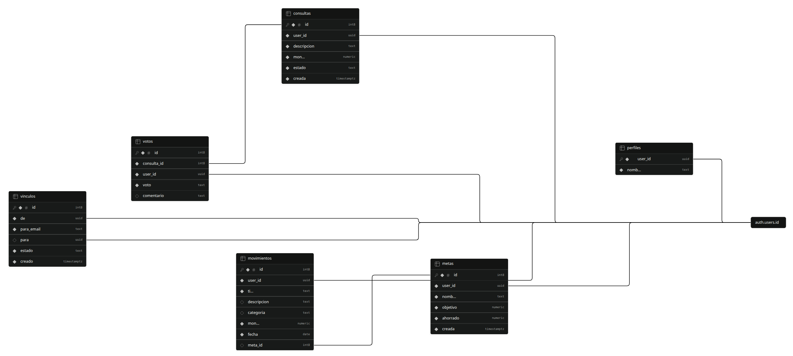

# Bolsillo Sano

**Tu aliado para controlar gastos y cumplir metas de ahorro.**

Bolsillo Sano es el prototipo web de una aplicación para ordenar la plata del mes,
ahorrar para metas concretas y, sobre todo, **frenar las compras impulsivas antes
de que ocurran**, con la ayuda de un "Tribunal de amigos".

🌐 **Ver la app publicada:** https://diegolavezzari.github.io/bolsillosano/

---

## Datos del trabajo práctico

| **Institución**           | IFTS N° 16                                   |
| ------------------------- | -------------------------------------------- |
| **Año**                   | Segundo año                                  |
| **Materia**               | Seminario de Actualización de Tecnología Web |
| **Profesora**             | Cristina Ferro Croce                         |
| **Trabajo práctico**      | Bolsillo Sano                                |
| **Período de desarrollo** | Septiembre – noviembre de 2026               |

### Integrantes

| Integrante | LinkedIn |
|---|---|
| Diego Lavezzari | [linkedin.com/in/diegolavezzari](https://www.linkedin.com/in/diegolavezzari/) |
| Sabrina Leal | [linkedin.com/in/sabrinalealv](https://www.linkedin.com/in/sabrinalealv/) |
| Arturo González | [linkedin.com/in/arturogonzalez92](https://www.linkedin.com/in/arturogonzalez92/) |

---

## La idea

### Caso de uso

> **Martina** (la usuaria de ejemplo) está por comprar unas zapatillas de $85.000.
> La app le muestra cuánto retrocede su meta de ahorro con esa compra y le da dos
> opciones para pensarlo mejor:
>
> 1. **Esperar 24 horas** antes de decidir.
> 2. Consultar al **Tribunal de amigos**, que vota si la compra vale la pena o no.

El nombre de la app es **Bolsillo Sano**. "Martina" es solo la persona del caso de uso.

### Qué se puede hacer en la app

- **Crear una cuenta** con confirmación por mail, ingresar y recuperar la contraseña.
- **Flujo:** cargar ingresos, gastos y compras evitadas del mes, por categoría.
- **Metas:** crear metas de ahorro, sumarles o restarles plata y ver el progreso.
- **Inicio:** resumen del mes (cuánto queda disponible), todas las metas con su
  barra de progreso y cuántas compras se evitaron.
- **Amigos:** invitar amigos por mail y aceptar invitaciones.
- **Tribunal:** consultar una compra a los amigos, votar las compras de ellos
  (a favor / en contra, con comentario) y decidir.
- **Inversiones:** test "¿Qué tipo de inversor sos?" (conservador, moderado o agresivo).
- **Consejos:** 10 consejos de finanzas personales y un video.
- **Nosotros:** el equipo y los datos de la materia.
- **Borrar mi cuenta** con todos sus datos.

---

## Tecnologías

| Tecnología | Para qué se usa |
|---|---|
| **HTML** | Estructura de cada pantalla (un archivo `.html` por pantalla). |
| **CSS** | Todos los estilos, en un único archivo compartido: `css/estilo.css`. |
| **JavaScript** | Interactividad. Un archivo por página, con el mismo nombre (`metas.html` → `js/metas.js`). |
| **Supabase** | Login con mail de confirmación y base de datos (PostgreSQL), usados directo desde el JS, sin servidor propio. |
| **Supabase CLI + Docker** | Base de datos local para probar y migraciones para cambiar la base. |
| **Git y GitHub** | Control de versiones. |
| **GitHub Pages** | Publicación gratuita de la app (se actualiza con cada `git push` a `main`). |

---

## Estructura del proyecto

```
bolsillosano/
├── index.html            Portada (bienvenida)
├── login.html            Ingresar + "¿Olvidaste tu contraseña?"
├── registro.html         Crear cuenta
├── nueva-password.html   Elegir contraseña nueva (desde el mail)
├── inicio.html           Panel del usuario
├── movimientos.html      "Flujo": ingresos, gastos y compras evitadas
├── metas.html            Metas de ahorro
├── amigos.html           Invitar y aceptar amigos
├── tribunal.html         Consultar y votar compras
├── inversiones.html      Test de perfil de inversor
├── consejos.html         10 consejos + video
├── nosotros.html         Equipo y carátula
│
├── css/
│   └── estilo.css        Estilos compartidos por todas las páginas
├── js/
│   ├── supabase.js       Conexión con Supabase (compartida)
│   └── <página>.js       Un archivo por cada página
├── img/                  Logo, íconos, fotos
└── supabase/
    ├── config.toml       Configuración de la base local
    └── migrations/       Cambios de la base, en orden
```

---

## Desarrollo paso a paso

### Paso 1 — Arranque del proyecto (septiembre 2026)

- Se creó el repositorio en GitHub y se clonó en la compu.
- Se armó la estructura de carpetas: los `.html` en la raíz y las carpetas
  `css/`, `js/` e `img/` aparte.
- Se partió de un prototipo de 18 pantallas y se eligieron las más importantes.
- Primeras pantallas: portada, inicio y metas.

### Paso 2 — Decisiones de base (4 de octubre)

- **Cada pantalla es un archivo `.html` separado.**
- **Un solo CSS compartido** y **un JS por página**.
- **Responsive, "mobile first":** primero se escribe el CSS para el celular y
  con `@media (min-width: 768px)` y `@media (min-width: 1024px)` se adapta a la
  compu. En pantallas grandes el contenido aprovecha el ancho.
- Tipografía `Arial, sans-serif`, sin fuentes externas.
- Pantallas de **login** y **registro** con validación.
- Plan de datos en 3 etapas: (1) todas las pantallas en HTML + CSS,
  (2) JS con `localStorage`, (3) Supabase.

### Paso 3 — Rediseño de la portada (11 de octubre)

- Diseño nuevo de fondo blanco, con verde (`#17795a`) y azules (`#14275e`,
  `#0f1d45`) como colores de la marca, guardados en variables CSS.
- **Barra de navegación flotante** con puntas redondeadas (`position: fixed`,
  `border-radius`), que se esconde al bajar y aparece al subir (JS con `scrollY`).
- **Portada** con foto de fondo, título "Bolsillo Sano es tu aliado" y frase
  "Te contamos nuestras herramientas...".
- **4 tarjetas** con degradé e íconos: Alertas a tiempo, Calculadora de gastos,
  Inversiones y Gestión de metas, con un botón "Ver más" (`classList.toggle`).
- Se publicó en **GitHub Pages** y el repositorio pasó a llamarse `bolsillosano`.

### Paso 4 — Test de inversores (11 de octubre)

- `inversiones.html`: 5 preguntas con botones de opción (`radio`). Cada
  respuesta vale puntos y el JS los suma:
  5–8 → **conservador**, 9–11 → **moderado**, 12–15 → **agresivo**.
- Si la persona no tiene fondo de emergencia, aparece primero un aviso.
- Basado en el test de perfil del inversor que usan bancos y brokers (horizonte,
  tolerancia a pérdidas, objetivo, situación financiera y experiencia).

### Paso 5 — Nosotros y Consejos (26 de octubre – 3 de noviembre)

- `nosotros.html`: fotos redondas de los 3 integrantes (de a uno en el celular,
  en fila en la compu).
- `consejos.html`: 10 consejos en tarjetas numeradas (regla 50/30/20, pagate
  primero, gastos hormiga, fondo de emergencia, esperar 24 hs, cuotas,
  inflación, suscripciones, etc.) y un **video de YouTube embebido** con `<iframe>`.
- Botón verde **"Ingresar"** en la barra de todas las páginas, con un ícono SVG
  (en el celular se ve solo el ícono).
- `login.html` y `registro.html` rehechos con el diseño nuevo: tarjeta blanca
  centrada y campos de 16px (si la letra es menor, el iPhone hace zoom solo).

### Paso 6 — Base de datos con Supabase (3 – 10 de noviembre)

- Se decidió **saltear `localStorage` e ir directo a Supabase** para el login.
- Se creó el proyecto en Supabase con **6 tablas**:

  | Tabla | Qué guarda |
  |---|---|
  | `metas` | Nombre, objetivo y cuánto se lleva ahorrado. |
  | `movimientos` | Ingresos, gastos, compras evitadas, ahorros y retiros, con monto, categoría y fecha. |
  | `perfiles` | El nombre de cada usuario (para mostrarlo a sus amigos). |
  | `vinculos` | Invitaciones de amistad por mail (pendiente / aceptada). |
  | `consultas` | Compras que alguien le consulta al tribunal. |
  | `votos` | Votos de los amigos, a favor o en contra, con comentario. |

- **Seguridad con RLS** (Row Level Security): cada usuario ve y cambia solo sus
  propios datos. En el JS va solo la clave pública (anon).
- **Login completo:** registro (`signUp`, con el nombre guardado en el usuario),
  ingreso (`signInWithPassword`), olvidé mi contraseña (`resetPasswordForEmail`)
  y contraseña nueva (`updateUser`).
- **Páginas protegidas:** si no hay sesión, inicio, flujo, metas, amigos y
  tribunal mandan a `login.html`. "Cerrar sesión" con `signOut()`.





### Paso 7 — Las pantallas de la app (10 de noviembre)

- **Flujo (`movimientos.html`):** tipo (ingreso / gasto / compra evitada), monto,
  descripción, categoría y fecha (hoy por defecto). Resumen del mes y lista con
  opción de borrar.
- **Metas (`metas.html`):** 5 lugares para metas nuevas (ninguno obligatorio),
  tarjetas con barra de progreso y botones **Sumar ahorro**, **Restar ahorro** y
  **Borrar meta**.
  - Lo que se ahorra **se descuenta del disponible** del mes, y no deja ahorrar
    más de lo que queda.
  - Restar ahorro devuelve la plata al disponible. Si se borra una meta, sus
    ahorros vuelven solos.
  - Disponible del mes = ingresos − gastos − ahorros + retiros.
- **Inicio (`inicio.html`):** "Hola, nombre", disponible del mes, todas las metas,
  resumen de compras evitadas y dinero protegido, aviso "Tenés N consultas del
  tribunal" y botón **Borrar mi cuenta**.
- **Amigos (`amigos.html`):** invitar por mail, aceptar o rechazar, desvincular.
- **Tribunal (`tribunal.html`):** consultar una compra, votar las de los amigos y
  cambiar el voto. Al decidir: "No la compro" → se guarda como **compra evitada**;
  "La compro igual" → se guarda como **gasto**. Los amigos ven solo qué se quiere
  comprar y cuánto cuesta, nunca las metas ni los movimientos.

### Paso 8 — Base local y migraciones (10 – 17 de noviembre)

- Con **Supabase CLI y Docker** se levantó una copia de la base en la compu, para
  probar sin tocar la real.
- `js/supabase.js` elige solo a qué base conectarse: si la página se abre en
  `localhost` usa la local; si no, la real.
- **Los cambios de la base se hacen con migraciones** (archivos SQL en
  `supabase/migrations/`), que se prueban en local y después se suben a la real:
  1. `remote_schema` — las 6 tablas, las reglas RLS y la creación automática del
     perfil al registrarse.
  2. `ahorro_y_borrar_cuenta` — movimientos de tipo "ahorro" ligados a su meta y
     la función para borrar la cuenta.
  3. `retiro_de_meta` — movimientos de tipo "retiro".
- Se unió todo a `main` y la app quedó funcionando en GitHub Pages.
- `nosotros.html`: carátula con los datos de la materia y links a LinkedIn.

### Paso 9 — Navegación con sesión iniciada (18 de noviembre)

- Una vez adentro, la barra muestra **todas las secciones**: Inicio · Flujo ·
  Metas · Amigos · Tribunal · Consejos · Inversiones · Nosotros, más
  **Cerrar sesión**. El logo lleva al inicio de la app.
- La página actual aparece resaltada en verde.
- En el celular la barra tiene 2 renglones (logo y botón arriba, links abajo);
  en pantallas grandes, una sola fila. La letra es la misma que en la portada.
- Consejos, Inversiones y Nosotros se fijan si hay sesión: si la hay, muestran la
  barra de adentro; si no, la pública con "Ingresar".

---

## Cómo probarlo en la compu

Realizamos todas las pruebas en la rama  "base-local" para luego hacer un merge al final del proyecto.

**Solo las páginas** (usa la base real):

```bash
python3 -m http.server 8000
```

y abrir http://localhost:8000. Conviene usar un servidor y no abrir el `.html`
con doble clic: así el video de YouTube y el login funcionan bien.

**Con la base local** (necesita Docker):

```bash
npx supabase start     # prende la base local
python3 -m http.server 8000
npx supabase stop      # la apaga (los datos quedan guardados)
```

- Panel de la base local: http://127.0.0.1:54323
- Mails de prueba (confirmaciones, recuperar contraseña): http://127.0.0.1:54324


---

## Pendientes

- [ ] Avisos push al tribunal (que les llegue una notificación a los amigos).
- [ ] Pantallas de Perfil y Logros.
- [ ] Usuarios de prueba cargados automáticamente en la base local.
- [ ] Calculadora de inversiones según el perfil (con inflación y plazo).
- [ ] Mejoras del test de inversores (explicar por qué salió cada perfil).

---

*Simulación con fines educativos. No es asesoramiento financiero.*
